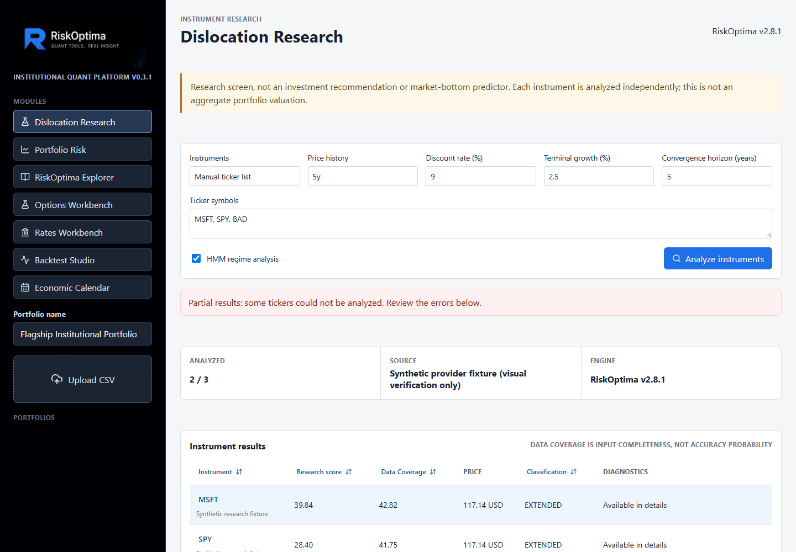
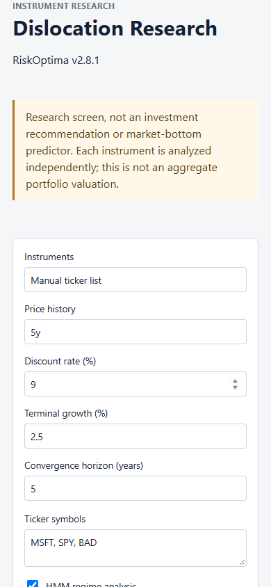

# Dislocation Research

The workspace uses `riskoptima.dislocation` from the local RiskOptima 2.8.0
checkout while that release is unpublished. Existing synthetic portfolio,
options, rates and backtest workflows remain separate from this live research
screen. This is instrument research, not aggregate portfolio valuation or an
investment recommendation.

The checkout may advance during development (currently 2.8.1); branding always
shows the actual imported version rather than relabeling it as 2.8.0.

## Run With the Local Library

Install the platform's existing backend requirements first. Create a root
`.env` with the following (use your own checkout path):

```dotenv
RISKOPTIMA_PLATFORM_RISKOPTIMA_PATH=C:/repo/portfolio_risk_kit
```

Start the API from the repository root so it reads that file:

```powershell
$env:PYTHONPATH = "backend"
backend/.venv/Scripts/python.exe -m uvicorn app.main:app --host 127.0.0.1 --port 8000
```

The local checkout overrides the installed 2.7.1 package for **all** analytics
in that process. Restart the API after changing the path. Verify the imported
version and source via `GET /api/library/metadata`; the research response and
reports retain actual RiskOptima version branding. The production requirements
remain pinned to the published release until 2.8.0 is available; a default
Docker build does not include this unpublished workspace engine. For a local
Docker preview on Windows:

```powershell
docker compose -f docker-compose.yml -f docker-compose.dislocation.yml up -d --build
```

Set `RISKOPTIMA_CHECKOUT` if the checkout is elsewhere. This mounts the library
read-only. Once 2.8.0 is published, pin both backend dependency files to 2.8.0,
remove the override and re-run the test suite before deployment.

## Workflow and API

Open **Dislocation Research** in the sidebar. Enter up to 25 Yahoo ticker
symbols, or choose holdings from the currently selected portfolio. Holdings
provide identifiers and labels only; weights and portfolio values are not
inputs. An ISIN may not be a provider ticker; failures never substitute another
instrument or synthetic history.

`POST /api/dislocation/scan` accepts:

```json
{
  "tickers": ["MSFT", "SPY"],
  "config": {
    "history_period": "5y",
    "discount_rate": 0.09,
    "terminal_growth": 0.025,
    "valuation_horizon_years": 5,
    "use_markov_regime": true
  }
}
```

Add `portfolio_id` to restrict symbols to that portfolio's saved holdings;
omitting tickers then selects all holdings, subject to the 25-instrument limit.
Configuration is validated by Pydantic and `DislocationConfig`. Single inputs
call `analyze_symbol`; multiple inputs call `scan_universe`. Analyses use
`as_dict()` and scanner rows use `to_json(orient="records")`, preserving JSON
nulls rather than NaN. Status is `success`, `partial`, or `failed`; all-error
runs retain error rows and show a failure. Invalid input returns 422, unknown
portfolios 404, and an unavailable library module 503.

Retrieval occurs only on the server. No results are persisted or cached in v1.
Yahoo availability and latency vary. The app has no authentication, so expose
live retrieval endpoints only to trusted users.

## Interpretation

- **Data Coverage** maps `confidence_score`: completeness, not probability of
  correctness, freshness or predictive skill.
- **Margin of safety** is `(model value - price) / model value`.
- **Upside to model value** is `model value / price - 1`.
- **Hypothetical annualized convergence** uses `implied_annualized_return`:
  convergence to today's model value over the chosen horizon, excluding
  distributions. It is not a forecast, market yield or total-return IRR.
- Equity DCF uses an unadjusted positive FCF proxy, without net borrowing or
  normalized FCFE reconciliation. Missing valuations remain unavailable.
- Funds/non-equities have price/regime analysis, no corporate DCF and no
  measured NAV discount. HMM regimes are descriptive, not out-of-sample signals.

Details display raw library metric names and values, source, price date, model
assumptions, diagnostics and versioned reports. Markdown disables raw HTML,
remote images and non-HTTP links. See the library's `docs/dislocation_model.md`
and notebook `14-dislocation_model_demo.ipynb` for the complete methodology.

## Verification

Backend and frontend regression tests use deterministic provider fixtures,
never live Yahoo data. Run `python -m pytest backend/tests` from the root with
`PYTHONPATH=backend`, and `npm test` / `npm run build` in `frontend/app`.
Desktop/mobile screenshots are under `docs/screenshots/dislocation-*.png`.
They show synthetic provider fixtures analyzed by the real local library,
explicitly labeled in the source field. Reproduce them with
`python scripts/verify-dislocation-ui.py` (install Playwright and Microsoft
Edge first); the script verifies sorting/report tables, partial failures,
fund details, all-error states and viewport overflow.




